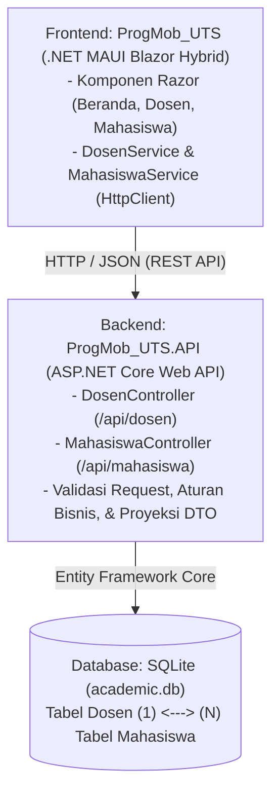

# Sistem Informasi Akademik Sederhana (UTS Pemrograman Mobile 2026)

## 1. Judul dan Deskripsi Aplikasi

**Sistem Informasi Akademik Sederhana** adalah aplikasi administrasi akademik berbasis *client-server* yang terdiri atas aplikasi klien **.NET MAUI Blazor Hybrid** (`ProgMob_UTS`) dan layanan backend **ASP.NET Core Web API** (`ProgMob_UTS.API`) dengan database **SQLite** melalui **Entity Framework Core**.

Aplikasi ini dirancang untuk membantu petugas administrasi akademik dalam memelihara data **Dosen** dan **Mahasiswa** beserta relasi **Dosen Wali** secara terpusat melalui komunikasi REST API (HTTP/JSON).

---

## 2. Tujuan Aplikasi

1. Menerapkan pemisahan tanggung jawab antara aplikasi *frontend* (.NET MAUI Blazor Hybrid), *backend* (ASP.NET Core Web API), dan *database* (SQLite) dalam satu solution `.NET`.
2. Menyediakan operasi CRUD (*Create, Read, Update, Delete*) lengkap untuk entitas **Dosen** dan **Mahasiswa**.
3. Mengimplementasikan relasi *one-to-many* menggunakan Entity Framework Core di mana satu dosen dapat menjadi dosen wali bagi banyak mahasiswa, dan setiap mahasiswa wajib memiliki satu dosen wali.
4. Menerapkan validasi input dan aturan bisnis akademik (seperti keunikan NIDN/NIM, validasi domain email `@kampus.ac.id` dan `@student.kampus.ac.id`, validasi rentang angkatan 2020–2026, serta penolakan penghapusan dosen yang masih menjadi dosen wali mahasiswa).

---

## 3. Daftar Fitur Wajib

### A. Modul Dosen

- Menampilkan daftar seluruh dosen (NIDN, Nama Dosen, Email, Program Studi).
- Menambahkan data dosen baru dengan validasi kelengkapan field, format email, domain wajib `@kampus.ac.id`, dan keunikan NIDN.
- Melihat detail lengkap data dosen.
- Mengubah (memperbarui) data dosen yang sudah ada.
- Menghapus data dosen dengan konfirmasi penghapusan (ditolak secara otomatis dengan pesan yang jelas apabila dosen tersebut masih terdaftar sebagai dosen wali mahasiswa).

### B. Modul Mahasiswa

- Menampilkan daftar seluruh mahasiswa beserta **Nama Dosen Wali** hasil proyeksi relasi dari backend.
- Menambahkan data mahasiswa baru dengan validasi NIM unik, rentang angkatan `2020–2026`, domain email wajib `@student.kampus.ac.id`, serta pilihan **Dropdown Dosen Wali** yang diambil secara dinamis dari endpoint API Dosen (`/api/dosen`).
- Melihat detail lengkap data mahasiswa beserta identitas dosen walinya.
- Mengubah data mahasiswa dan memindahkan dosen walinya melalui dropdown.
- Menghapus data mahasiswa dengan konfirmasi penghapusan.

### C. Perilaku Antarmuka & Penanganan Kesalahan

- Indikator *loading* saat memuat atau menyimpan data.
- Informasi yang jelas apabila data kosong atau apabila server API belum dijalankan / tidak dapat dihubungi.
- Tombol **Simpan** dinonaktifkan selama proses pengiriman berlangsung untuk mencegah pengiriman ganda.
- Pembaruan daftar otomatis setelah operasi tambah, ubah, atau hapus berhasil.

---

## 4. Teknologi yang Digunakan

| Komponen | Teknologi |
| :--- | :--- |
| **Frontend** | .NET MAUI Blazor Hybrid (`net10.0-windows10.0.19041.0`, `net10.0-android`, `net10.0-ios`, `net10.0-maccatalyst`) |
| **Backend** | ASP.NET Core Web API (`net10.0`) |
| **Bahasa Pemrograman** | C# |
| **ORM** | Entity Framework Core (`Microsoft.EntityFrameworkCore.Sqlite` & `Tools` `10.0.13`) |
| **Database** | SQLite (`academic.db`) |
| **Komunikasi Data** | REST API (HTTP & JSON menggunakan `HttpClient`) |
| **Pengujian & Dokumentasi API** | Swagger / OpenAPI (`Swashbuckle.AspNetCore`) |

---

## 5. Gambaran Arsitektur Aplikasi

Aplikasi menggunakan arsitektur tiga lapis (*three-tier architecture*):



> **Catatan Penting:** Proyek *frontend* (`ProgMob_UTS`) sama sekali tidak mengakses database SQLite secara langsung, melainkan hanya berkomunikasi dengan *backend* (`ProgMob_UTS.API`) melalui `HttpClient`.

---

## 6. Struktur Folder Proyek

```text
ProgMob_UTS/ (Root Solution Directory)
|-- ProgMob_UTS.slnx                         # File Solution .NET
|-- README.md                                # Dokumentasi Teknis Proyek
|-- LEARNING_GUIDE.md                        # Dokumentasi Pembelajaran & Bedah Kode Lengkap
|
|-- ProgMob_UTS.API/                         # Proyek Backend (ASP.NET Core Web API)
|   |-- Controllers/
|   |   |-- DosenController.cs               # Endpoint CRUD Dosen (/api/dosen)
|   |   \-- MahasiswaController.cs           # Endpoint CRUD Mahasiswa (/api/mahasiswa)
|   |-- Data/
|   |   \-- AcademicDbContext.cs             # DbContext, Relasi One-to-Many, & Data Seeding
|   |-- DTOs/
|   |   |-- DosenDto.cs                      # DTO Request & Response Dosen
|   |   \-- MahasiswaDto.cs                  # DTO Request & Response Mahasiswa (+ NamaDosenWali)
|   |-- Models/
|   |   |-- Dosen.cs                         # Entitas Tabel Dosen
|   |   \-- Mahasiswa.cs                     # Entitas Tabel Mahasiswa
|   |-- Validation/
|   |   \-- AllowedEmailDomainAttribute.cs   # Custom Validator domain email (@kampus.ac.id / @student.kampus.ac.id)
|   |-- Migrations/                          # File EF Core Migration (InitialCreate)
|   |-- Properties/
|   |   \-- launchSettings.json              # Konfigurasi port lokal (http://localhost:5008)
|   |-- appsettings.json                     # Konfigurasi Connection String SQLite
|   |-- Program.cs                           # Konfigurasi Layanan, Swagger, & Migrasi Otomatis
|   \-- ProgMob_UTS.API.csproj
|
\-- ProgMob_UTS/                             # Proyek Frontend (.NET MAUI Blazor Hybrid)
    |-- Components/
    |   |-- Layout/
    |   |   |-- MainLayout.razor             # Layout utama aplikasi
    |   |   \-- NavMenu.razor                # Menu navigasi (Beranda, Data Dosen, Data Mahasiswa)
    |   |-- Pages/
    |   |   |-- Home.razor                   # Halaman Beranda
    |   |   |-- NotFound.razor               # Halaman rute tidak ditemukan
    |   |   |-- Dosen/
    |   |   |   |-- DosenIndex.razor         # Daftar & Hapus Dosen
    |   |   |   |-- DosenForm.razor          # Form Tambah & Edit Dosen
    |   |   |   \-- DosenDetail.razor        # Detail Dosen
    |   |   \-- Mahasiswa/
    |   |       |-- MahasiswaIndex.razor     # Daftar & Hapus Mahasiswa
    |   |       |-- MahasiswaForm.razor      # Form Tambah & Edit Mahasiswa (+ Dropdown Dosen Wali)
    |   |       \-- MahasiswaDetail.razor    # Detail Mahasiswa
    |   |-- Routes.razor
    |   \-- _Imports.razor
    |-- Models/
    |   |-- ApiResult.cs                     # Pembungkus hasil operasi API & parser pesan error
    |   |-- DosenModel.cs                    # Model & validasi form Dosen di frontend
    |   \-- MahasiswaModel.cs                # Model & validasi form Mahasiswa di frontend
    |-- Services/
    |   |-- DosenService.cs                  # Service HttpClient untuk /api/dosen
    |   \-- MahasiswaService.cs              # Service HttpClient untuk /api/mahasiswa
    |-- Validation/
    |   \-- AllowedEmailDomainAttribute.cs   # Custom Validator domain email pada form Blazor
    |-- wwwroot/
    |   |-- app.css                          # Styling bersih & minimalis
    |   \-- index.html
    |-- App.xaml / App.xaml.cs
    |-- MainPage.xaml / MainPage.xaml.cs
    |-- MauiProgram.cs                       # Registrasi DI HttpClient & Services
    \-- ProgMob_UTS.csproj
```

---

## 7. Persyaratan Instalasi

Sebelum menjalankan proyek ini pada komputer lokal, pastikan perangkat berikut telah terpasang:

1. **.NET SDK 10.0** (diuji menggunakan `.NET SDK 10.0.401`). Periksa dengan perintah:

   ```powershell
   dotnet --version
   ```

2. **Workload .NET MAUI** (minimal `maui-windows` untuk menjalankan pada Windows Desktop, atau `android` untuk emulator Android):

   ```powershell
   dotnet workload list
   ```

3. **EF Core CLI Tool (`dotnet-ef`)** (opsional jika ingin menjalankan perintah migrasi manual):

   ```powershell
   dotnet tool install --global dotnet-ef
   ```

4. **Visual Studio 2022 / 2026** (dengan workload *.NET Multi-platform App UI development* dan *ASP.NET and web development*) atau terminal PowerShell / Command Prompt.

---

## 8. Cara Mengonfigurasi Connection String SQLite dan Alamat API

### A. Konfigurasi Connection String SQLite (Backend)

Connection string dikonfigurasi pada file `ProgMob_UTS.API/appsettings.json`:

```json
{
  "ConnectionStrings": {
    "DefaultConnection": "Data Source=academic.db"
  }
}
```

File database `academic.db` akan otomatis dibuat di dalam folder kerja `ProgMob_UTS.API`.

### B. Konfigurasi Alamat Web API (Frontend)

Alamat dasar (*BaseAddress*) API dikonfigurasi pada file `ProgMob_UTS/MauiProgram.cs`:

```csharp
var apiBaseUrl = DeviceInfo.Platform == DevicePlatform.Android
    ? "http://10.0.2.2:5008/"
    : "http://localhost:5008/";
```

- Jika dijalankan pada **Windows** atau **MacCatalyst**, aplikasi menggunakan `http://localhost:5008/`.
- Jika dijalankan pada **Android Emulator**, aplikasi otomatis menggunakan `http://10.0.2.2:5008/` yang mengarah ke `localhost` komputer host.
- Pastikan port tersebut sesuai dengan `applicationUrl` pada `ProgMob_UTS.API/Properties/launchSettings.json` (`http://localhost:5008`).

---

## 9. Cara Menjalankan Migration dan Membuat Database

Migration awal (`InitialCreate`) sudah disertakan di dalam folder `ProgMob_UTS.API/Migrations/`. Selain itu, pada `ProgMob_UTS.API/Program.cs` telah ditambahkan perintah `dbContext.Database.Migrate()` sehingga **database dan data awal otomatis dibuat saat backend dijalankan**.

Jika Anda ingin menjalankan atau menerapkan migration secara manual pada komputer baru melalui terminal, jalankan perintah berikut dari root folder solution:

```powershell
dotnet ef database update --project ProgMob_UTS.API
```

Jika ingin membuat ulang database dari kondisi kosong:

```powershell
dotnet ef database drop --project ProgMob_UTS.API --force
dotnet ef database update --project ProgMob_UTS.API
```

---

## 10. Cara Menjalankan Backend

> **PENTING:** Jalankan proyek **Backend (`ProgMob_UTS.API`) terlebih dahulu** sebelum membuka dan menggunakan aplikasi Frontend (`ProgMob_UTS`).

Buka terminal pada root folder solution, lalu jalankan:

```powershell
dotnet run --project ProgMob_UTS.API --launch-profile http
```

Server API akan aktif dan mendengarkan pada alamat:
- **Base URL API:** `http://localhost:5008`
- **Swagger UI:** `http://localhost:5008/swagger`

---

## 11. Cara Menguji Endpoint Melalui Swagger

1. Pastikan backend sedang berjalan (`dotnet run --project ProgMob_UTS.API --launch-profile http`).
2. Buka browser dan akses alamat `http://localhost:5008/swagger`.
3. Anda akan melihat dua grup endpoint utama: **Dosen** (`/api/dosen`) dan **Mahasiswa** (`/api/mahasiswa`).
4. Klik salah satu endpoint (misalnya `GET /api/dosen`), klik tombol **Try it out**, lalu klik **Execute** untuk melihat respons JSON beserta kode status HTTP-nya.

---

## 12. Cara Menjalankan Frontend

Pastikan backend sudah berjalan di terminal pertama. Selanjutnya, Anda dapat menjalankan frontend dengan salah satu cara berikut:

### Opsi A: Melalui Terminal CLI (Windows Desktop)

Buka terminal kedua pada root folder solution, lalu jalankan:

```powershell
dotnet build ProgMob_UTS/ProgMob_UTS.csproj -f net10.0-windows10.0.19041.0
dotnet run --project ProgMob_UTS/ProgMob_UTS.csproj -f net10.0-windows10.0.19041.0
```

### Opsi B: Melalui Visual Studio

1. Buka file `ProgMob_UTS.slnx` di Visual Studio.
2. Klik kanan pada Solution -> **Configure Startup Projects...** -> pilih **Multiple startup projects**, lalu atur `ProgMob_UTS.API` dan `ProgMob_UTS` menjadi **Start** (atau jalankan `ProgMob_UTS.API` terlebih dahulu, kemudian jalankan `ProgMob_UTS` dengan target **Windows Machine**).

---

## 13. Daftar Endpoint Beserta Method dan Fungsinya

### Endpoint Dosen (`/api/dosen`)

| Method | Endpoint | Fungsi | Status Sukses | Status Gagal |
| :--- | :--- | :--- | :--- | :--- |
| `GET` | `/api/dosen` | Mengambil seluruh daftar dosen | `200 OK` | - |
| `GET` | `/api/dosen/{id}` | Mengambil detail dosen berdasarkan ID | `200 OK` | `404 Not Found` |
| `POST` | `/api/dosen` | Menambahkan data dosen baru | `201 Created` | `400 Bad Request`, `409 Conflict` (NIDN duplikat) |
| `PUT` | `/api/dosen/{id}` | Memperbarui data dosen berdasarkan ID | `200 OK` | `400 Bad Request`, `404 Not Found`, `409 Conflict` |
| `DELETE` | `/api/dosen/{id}` | Menghapus dosen (jika tidak menjadi dosen wali) | `204 No Content` | `404 Not Found`, `409 Conflict` (masih menjadi wali) |

### Endpoint Mahasiswa (`/api/mahasiswa`)

| Method | Endpoint | Fungsi | Status Sukses | Status Gagal |
| :--- | :--- | :--- | :--- | :--- |
| `GET` | `/api/mahasiswa` | Mengambil seluruh mahasiswa beserta `namaDosenWali` | `200 OK` | - |
| `GET` | `/api/mahasiswa/{id}` | Mengambil detail mahasiswa beserta `namaDosenWali` | `200 OK` | `404 Not Found` |
| `POST` | `/api/mahasiswa` | Menambahkan data mahasiswa baru | `201 Created` | `400 Bad Request` (input/DosenId tidak valid), `409 Conflict` (NIM duplikat) |
| `PUT` | `/api/mahasiswa/{id}` | Memperbarui data mahasiswa dan dosen walinya | `200 OK` | `400 Bad Request`, `404 Not Found`, `409 Conflict` |
| `DELETE` | `/api/mahasiswa/{id}` | Menghapus data mahasiswa berdasarkan ID | `204 No Content` | `404 Not Found` |

---

## 14. Penjelasan Model Dosen, Mahasiswa, dan Relasinya

### Entitas `Dosen`

- `DosenId` (`int`): Primary key, *auto-increment*.
- `Nidn` (`string`): Wajib diisi, unik (memiliki *unique index* `IX_Dosen_Nidn`), maksimal 20 karakter.
- `NamaDosen` (`string`): Wajib diisi, maksimal 100 karakter.
- `Email` (`string`): Wajib diisi, format email valid, wajib menggunakan domain `@kampus.ac.id` (`AllowedEmailDomainAttribute`), maksimal 100 karakter.
- `Prodi` (`string`): Wajib diisi, maksimal 100 karakter.
- `MahasiswaBimbingan` (`ICollection<Mahasiswa>`): Properti navigasi daftar mahasiswa bimbingan.

### Entitas `Mahasiswa`

- `MahasiswaId` (`int`): Primary key, *auto-increment*.
- `Nim` (`string`): Wajib diisi, unik (memiliki *unique index* `IX_Mahasiswa_Nim`), maksimal 20 karakter.
- `NamaMahasiswa` (`string`): Wajib diisi, maksimal 100 karakter.
- `Email` (`string`): Wajib diisi, format email valid, wajib menggunakan domain `@student.kampus.ac.id` (`AllowedEmailDomainAttribute`), maksimal 100 karakter.
- `Angkatan` (`int`): Wajib diisi, berada pada rentang `2020` hingga `2026`.
- `DosenId` (`int`): Foreign key wajib yang merujuk pada `Dosen.DosenId`.
- `DosenWali` (`Dosen?`): Properti navigasi ke objek dosen wali.

### Relasi Database (One-to-Many)

- **Dosen (1) ---- (N) Mahasiswa**
- Dikonfigurasi pada `AcademicDbContext.OnModelCreating` menggunakan Fluent API dengan `OnDelete(DeleteBehavior.Restrict)`.
- Pada endpoint `GET /api/mahasiswa`, data diproyeksikan menggunakan LINQ `.Select()` ke `MahasiswaDto` yang menyertakan properti `NamaDosenWali` sehingga terhindar dari perulangan objek JSON (*circular reference*).

---

## 15. Data Akun dan Data Uji Awal (Seeding)

Aplikasi ini **tidak menggunakan sistem login/autentikasi** sesuai batasan ruang lingkup proyek. Pengguna dapat langsung mengakses seluruh fitur saat aplikasi dibuka.

Database telah dilengkapi dengan data awal (*seed data*) yang terdiri atas **3 Dosen** dan **5 Mahasiswa**:

### Data Awal Dosen

| DosenId | NIDN | Nama Dosen | Email | Program Studi |
| :--- | :--- | :--- | :--- | :--- |
| 1 | `0512038801` | Dr. Anita Wijaya, S.Kom., M.Cs. | `anita.wijaya@kampus.ac.id` | Sistem Informasi |
| 2 | `0524078502` | Ir. Bambang Pratama, M.Kom. | `bambang.pratama@kampus.ac.id` | Informatika |
| 3 | `0509119003` | Siti Rahmawati, S.Kom., M.T. | `siti.rahmawati@kampus.ac.id` | Sistem Informasi |

### Data Awal Mahasiswa

| MahasiswaId | NIM | Nama Mahasiswa | Email | Angkatan | DosenId (Dosen Wali) |
| :--- | :--- | :--- | :--- | :--- | :--- |
| 1 | `72230001` | Budi Santoso | `budi.santoso@student.kampus.ac.id` | 2023 | 1 (Dr. Anita Wijaya, S.Kom., M.Cs.) |
| 2 | `72230002` | Clara Kusuma | `clara.kusuma@student.kampus.ac.id` | 2023 | 1 (Dr. Anita Wijaya, S.Kom., M.Cs.) |
| 3 | `71220003` | Dimas Saputra | `dimas.saputra@student.kampus.ac.id` | 2022 | 2 (Ir. Bambang Pratama, M.Kom.) |
| 4 | `72240004` | Eka Putri Lestari | `eka.lestari@student.kampus.ac.id` | 2024 | 2 (Ir. Bambang Pratama, M.Kom.) |
| 5 | `72250005` | Farhan Nugroho | `farhan.nugroho@student.kampus.ac.id` | 2025 | 3 (Siti Rahmawati, S.Kom., M.T.) |

---

## 16. Daftar Skenario Pengujian dan Hasil yang Diharapkan

Berikut adalah daftar skenario pengujian minimum yang telah diverifikasi:

| Kode | Skenario Pengujian | Langkah Pengujian | Hasil yang Diharapkan | Status |
| :--- | :--- | :--- | :--- | :--- |
| **T01** | Menambah dosen dengan data valid | Kirim data dosen baru dengan NIDN unik, nama, email `@kampus.ac.id`, dan prodi | Status `201 Created`, data tersimpan di SQLite dan tampil pada daftar dosen | Terverifikasi |
| **T02** | Menolak dosen dengan format/domain email tidak valid | Isi email tanpa format yang benar (`email-salah`), domain luar (`anita@gmail.com`), atau domain mahasiswa (`anita@student.kampus.ac.id`) | Validasi `AllowedEmailDomainAttribute` menolak penyimpanan (`400 Bad Request` pada API / pesan validasi pada form) | Terverifikasi |
| **T03** | Menolak NIDN duplikat | Tambah dosen dengan NIDN `0512038801` yang sudah terdaftar | API mengembalikan `409 Conflict` dengan pesan bahwa NIDN sudah terdaftar | Terverifikasi |
| **T04** | Menambah mahasiswa dengan dosen wali tersedia | Tambah mahasiswa baru dengan email `@student.kampus.ac.id`, `DosenId = 1`, dan angkatan `2024` | Status `201 Created`, data tersimpan dan daftar mahasiswa menampilkan nama dosen wali | Terverifikasi |
| **T04b** | Menolak mahasiswa dengan domain email tidak sesuai | Isi email mahasiswa dengan `budi@gmail.com` atau domain dosen `budi@kampus.ac.id` | Validasi menolak dengan pesan `"Email mahasiswa harus menggunakan domain @student.kampus.ac.id."` (`400 Bad Request`) | Terverifikasi |
| **T05** | Mengubah data mahasiswa dan dosen walinya | Ubah `DosenId` mahasiswa dari `1` menjadi `2` melalui `PUT /api/mahasiswa/{id}` | Status `200 OK`, kolom Dosen Wali pada daftar mahasiswa berubah sesuai dosen baru | Terverifikasi |
| **T06** | Menghapus mahasiswa | Hapus mahasiswa dengan konfirmasi (`DELETE /api/mahasiswa/{id}`) | Status `204 No Content`, data mahasiswa terhapus dari daftar dan database | Terverifikasi |
| **T07** | Menolak penghapusan dosen yang masih menjadi wali | Hapus dosen `DosenId = 1` yang masih membimbing mahasiswa | API mengembalikan `409 Conflict` dengan pesan bahwa dosen masih menjadi dosen wali | Terverifikasi |
| **T08** | Menghapus dosen tanpa mahasiswa bimbingan | Tambah dosen baru (belum menjadi wali), lalu hapus dosen tersebut | Status `204 No Content`, dosen berhasil dihapus | Terverifikasi |
| **T09** | Mengakses ID yang tidak ditemukan | Panggil `GET /api/dosen/999` atau `GET /api/mahasiswa/999` | API mengembalikan `404 Not Found` beserta pesan bahwa data tidak ditemukan | Terverifikasi |
| **T10** | Penanganan saat API tidak aktif | Buka halaman Dosen/Mahasiswa pada frontend saat `ProgMob_UTS.API` dimatikan | Aplikasi tidak *crash* dan menampilkan pesan peringatan bahwa server API tidak dapat dihubungi beserta tombol *Coba Muat Ulang* | Terverifikasi |

---

## 17. Cara Mengatasi Masalah Umum (Troubleshooting)

1. **Pesan *"Tidak dapat terhubung ke server API"* pada Frontend**
   - **Penyebab:** Proyek backend `ProgMob_UTS.API` belum dijalankan atau berjalan pada port yang berbeda.
   - **Solusi:** Jalankan `dotnet run --project ProgMob_UTS.API --launch-profile http` terlebih dahulu dan pastikan dapat diakses melalui `http://localhost:5008/swagger`.

2. **Database Belum Terbuat atau Data Awal Kosong**
   - **Penyebab:** File `academic.db` terhapus atau migrasi belum diterapkan.
   - **Solusi:** Jalankan kembali `ProgMob_UTS.API` (migrasi akan otomatis dijalankan saat startup), atau jalankan perintah `dotnet ef database update --project ProgMob_UTS.API`.

3. **Penghapusan Dosen Gagal (Status 409 Conflict)**
   - **Penyebab:** Dosen tersebut masih menjadi dosen wali bagi satu atau lebih mahasiswa pada tabel Mahasiswa.
   - **Solusi:** Ubah terlebih dahulu dosen wali mahasiswa yang bersangkutan ke dosen lain pada menu **Data Mahasiswa**, atau hapus mahasiswa bimbingannya sebelum menghapus dosen tersebut.

---

## 18. Sumber dan Alat Bantu yang Digunakan

1. **Dokumentasi Resmi Microsoft:**
   - [ASP.NET Core Web API Documentation](https://learn.microsoft.com/aspnet/core/web-api/)
   - [Entity Framework Core SQLite Provider & Migrations](https://learn.microsoft.com/ef/core/)
   - [.NET MAUI Blazor Hybrid Documentation](https://learn.microsoft.com/aspnet/core/blazor/hybrid/tutorials/maui)
2. **Alat Bantu Pengembangan:**
   - .NET 10 SDK & CLI (`dotnet`, `dotnet-ef`)
   - Swashbuckle.AspNetCore (Swagger UI)
   - AI Coding Assistant (Google DeepMind Antigravity) untuk membantu penyusunan struktur kode, komentar dokumentasi XML Bahasa Indonesia, pengujian skenario endpoint, dan penyusunan dokumentasi README.
